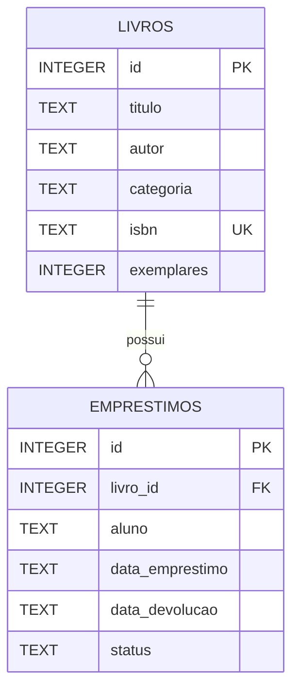

# Relatório técnico — Biblioteca Senac

## 1. Objetivo
O sistema organiza o catálogo da biblioteca e controla empréstimos e devoluções. A aplicação permite cadastrar, consultar, alterar e remover livros, além de registrar a circulação dos exemplares.

## 2. Tecnologias
- **Python 3:** linguagem da aplicação.
- **Flask:** framework web responsável pelas rotas.
- **SQLite:** banco de dados relacional em arquivo.
- **HTML, CSS e JavaScript:** interface do usuário.
- **JSON:** formato de resposta da API.

## 3. Modelo de dados e DER



**Relacionamento:** um livro pode aparecer em vários registros de empréstimo. Cada empréstimo pertence a um único livro. A chave estrangeira `emprestimos.livro_id` referencia `livros.id`.

## 4. Dicionário de dados

### Tabela `livros`

| Campo | Tipo | Regra | Descrição |
|---|---|---|---|
| id | INTEGER | PK, autoincremento | Identificador do livro |
| titulo | TEXT | NOT NULL | Título da obra |
| autor | TEXT | NOT NULL | Autor da obra |
| categoria | TEXT | NOT NULL | Categoria ou assunto |
| isbn | TEXT | UNIQUE, opcional | Código ISBN, quando informado |
| exemplares | INTEGER | NOT NULL, >= 0 | Quantidade total de exemplares |

### Tabela `emprestimos`

| Campo | Tipo | Regra | Descrição |
|---|---|---|---|
| id | INTEGER | PK, autoincremento | Identificador do empréstimo |
| livro_id | INTEGER | FK, NOT NULL | Livro relacionado |
| aluno | TEXT | NOT NULL | Nome de quem retirou |
| data_emprestimo | TEXT | NOT NULL | Data da retirada (AAAA-MM-DD) |
| data_devolucao | TEXT | Opcional | Data da devolução |
| status | TEXT | Emprestado ou Devolvido | Situação do empréstimo |

## 5. Operações implementadas
- **Create:** cadastro de livros e registro de empréstimos.
- **Read:** listagem do catálogo, consulta de disponibilidade e histórico.
- **Update:** edição dos dados de livros e alteração do status ao devolver.
- **Delete:** remoção de livros sem histórico e exclusão de registros de empréstimo.

Um livro com histórico não pode ser removido para preservar a integridade referencial. A quantidade disponível é calculada subtraindo os empréstimos ativos do total de exemplares.

## 6. API
- `GET /api/livros`: retorna uma lista JSON com dados do catálogo, quantidade emprestada e quantidade disponível.
- `GET /api/emprestimos`: retorna os empréstimos e o título do livro associado.

Exemplo de resposta simplificada de `/api/livros`:

```json
[
  {
    "id": 1,
    "titulo": "O Pequeno Príncipe",
    "autor": "Antoine de Saint-Exupéry",
    "exemplares": 5,
    "emprestados": 1,
    "disponiveis": 4
  }
]
```

## 7. Observações
O banco de dados é inicializado automaticamente com registros de demonstração quando está vazio. O sistema foi pensado para apresentação acadêmica. Em produção, recomenda-se autenticação, validação mais ampla, cópias de segurança e armazenamento persistente no serviço de hospedagem.
